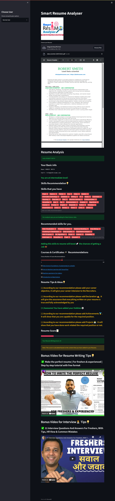
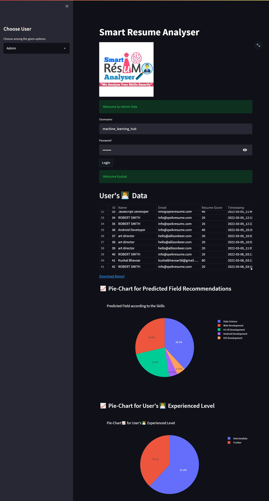

# AI Resume Analyser App

[](https://www.python.org/downloads/release/python-360/)

<!-- ## [Get the project Report, PPT, and Diagrams](https://kushalbhavsar1820.stores.instamojo.com/product/864991/smart-resume-analyzer-ppt-report-and-diagram-c091f/) -->

## Source

- Extracting user's information from the Resume, I used [PyResparser](https://omkarpathak.in/pyresparser/)
- Extracting Resume PDF into Text, I used [PDFMiner](https://pypi.org/project/pdfminer/).

## Features

- User's & Admin Section
- Resume Score
- Career Recommendations
- Resume writing Tips suggestions
- Courses Recommendations
- Skills Recommendations
- Youtube video recommendations

## Usage

1. Open PowerShell in the project folder:

   ```powershell
   cd "Resume-Analyzer"
   ```

2. Create and activate a virtual environment:

   ```powershell
   py -m venv venv
   .\venv\Scripts\Activate.ps1
   ```

3. Install Python dependencies:

   ```powershell
   pip install -r requirements.txt
   ```

4. Download the required spaCy language model used by the app:

   ```powershell
   python -m spacy download en_core_web_sm
   ```

5. Start MySQL/XAMPP and ensure Apache and MySQL services are running.
   The app connects to MySQL using the details configured in `App.py` (`root` / `pass123`).

6. Run the application:

   ```powershell
   streamlit run App.py
   ```

7. Open the local URL shown in the terminal, usually:
   ```text
   http://localhost:8501
   ```

- `App.py` is the main Streamlit web application file.
- `Courses.py` contains the course and YouTube recommendations.
- `Uploaded_Resumes` stores uploaded resumes.
- `Classifier.py` contains the KNN-based classifier logic.
- Admin credentials: username `hanna123`, password `hanna123`.

For more explanation of this project, see the tutorial on the Machine Learning Hub YouTube channel.

## Screenshots

## User side



## Admin Side


<!-- ## Admin Side
 -->
